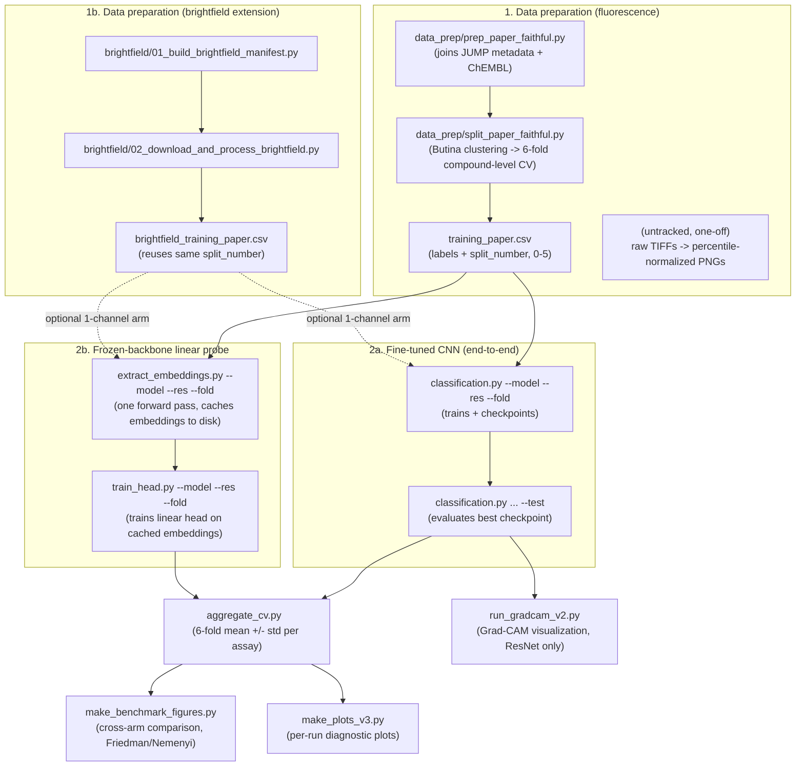

# Cell Painting Bioactivity Prediction with Pretrained Vision Models

Replication and extension of Fredin Haslum et al., *Nature Communications* 15:3470 (2024). The task is to predict
compound bioactivity (29 assays) from Cell Painting images. We reproduce the supervised ResNet-50 baseline and compare it
with ResNet-18, EfficientNet-B3 and pretrained vision backbones (DINOv2, DINOv3, Cell-DINO, CLIP, BiomedCLIP; frozen linear
probe and LoRA), on the same six compound-level folds. Further studies: brightfield versus fluorescence input and
explainability of the frozen models. The code builds on the original authors' repository (Apache-2.0); see `NOTICE`.

## Results

Mean test ROC-AUC over 29 assays, 6-fold cross-validation, compound-level aggregation (as in the original paper).


| Regime | Model | Resolution | Test ROC-AUC (6-fold CV) |
|---|---|---|---|
| Fine-tuned | ResNet-50 | 448 | **0.6792 ± 0.0245** |
| Fine-tuned | ResNet-18 | 448 | 0.6759 ± 0.0218 |
| Fine-tuned | EfficientNet-B3 | 448 | 0.6692 ± 0.0118 |
| Fine-tuned | ResNet-50 | 224 | 0.6638 ± 0.0153 |
| Fine-tuned | EfficientNet-B3 | 224 | 0.6622 ± 0.0254 |
| Fine-tuned | ResNet-18 | 224 | 0.6611 ± 0.0145 |
| Frozen probe | DINOv2-Large | 448 | 0.6412 ± 0.0170 |
| Frozen probe | DINOv3-Base | 448 | 0.6398 ± 0.0192 |
| LoRA (2.4% trainable) | DINOv2-Small + LoRA | 224 | 0.6373 ± 0.0203 |
| Frozen probe | DINOv2-Base | 448 | 0.6371 ± 0.0124 |
| Frozen probe | Cell-DINO | 224 | 0.6333 ± 0.0115 |
| Frozen probe | Cell-DINO | 448 | 0.6333 ± 0.0132 |
| Frozen probe | DINOv2-Large | 224 | 0.6299 ± 0.0218 |
| Frozen probe | DINOv3-Base | 224 | 0.6281 ± 0.0159 |
| Frozen probe | DINOv2-Base | 224 | 0.6272 ± 0.0190 |
| Frozen probe | DINOv2-Small | 224 | 0.6259 ± 0.0121 |
| Frozen probe | CLIP ViT-L/14 (locked recipe) | 224 | 0.6257 ± 0.0160 |
| Frozen probe | BiomedCLIP | 224 | 0.6214 ± 0.0127 |

The original paper reports 0.660 +/- 0.094 on the public JUMP-CP benchmark. It is an external reference, not a row of this table.

- Fine-tuned CNNs are the strongest models. ResNet-50 at 448 px is best (0.679); the three CNNs at 448 px are not significantly different from one another.
- The frozen probes span 0.621 to 0.641 and no frozen pair separates: neither pretraining domain nor model size gives a reliable advantage.
- Resolution (224 to 448 px) has a small positive effect (+0.010 to +0.015) within the fold-to-fold standard deviation.
- LoRA on DINOv2-Small is +0.011 above its frozen backbone.
- Brightfield versus fluorescence (ResNet-50, 448 px, 102 plates): no significant difference (-0.016 AUC, p = 0.19).
- Explainability (65 random targets): occlusion is the only method that clearly beats image-independent control maps; ViT-CX is not clearly better than a centre blob.
- Caveat: one frozen recipe (lr 0.02, chosen in a fold-0 sweep on Cell-DINO) is used for all frozen backbones, while ResNet-50 and LoRA are tuned individually.

Statistics, the brightfield study and the explainability results are in [docs/RESULTS_DETAILS.md](docs/RESULTS_DETAILS.md).
Why the frozen-probe results are scored per compound, and the history of the re-runs: [docs/EVALUATION_NOTES.md](docs/EVALUATION_NOTES.md).
Numbers in this README can be re-checked with `python3 verify/verify_claims.py`.
EfficientNet-B3 and ResNet-18 were configured and trained by Bhartendu Parihar (details in the same document).


## Repository layout

Run every command from the repository root. Scripts in the subfolders find the root entry points and the
libraries by themselves; if an import ever fails, run `export PYTHONPATH=$PWD` first.

- `classification.py`, `extract_embeddings.py`, `train_head.py`, `dump_predictions.py` - entry points (repository root): train and test one model, cache frozen embeddings, train the linear head, dump predictions
- `defaults/`, `utils/`, `params/`, `src/` - model definitions, trainer, datasets, losses and metrics, one JSON config per model, JUMP-CP metadata
- `data_prep/` - data preparation (JUMP-CP + ChEMBL) and download notes
- `analysis/` - cross-validation aggregation, statistics (Friedman/Nemenyi, Wilcoxon), benchmark figures and tables
- `brightfield/` - brightfield versus fluorescence study: download and preparation, first-layer adaptation checks, cross-modality control
- `explainability/` - ViT-CX, occlusion, Grad-CAM, per-stain ablation, gradient x input, foreground/background masking, summary figures
- `cluster/` - job generators and example Kubernetes job files (paths are those of our cluster and must be adapted)
- `data_lists/` - `targets_random65.csv`: the 65 random (compound, assay) targets used in all explainability experiments
- `results/` - all result tables and selected figures, one folder per experiment (read by `verify/verify_claims.py`)
- `verify/` - `verify_claims.py` re-checks the numbers in this README against the committed result files
- `docs/` - methodology and results document; `docs/UPSTREAM_COMPARISON.md` lists every difference from the original repository
- `NOTICE`, `CITATION.cff`, `LICENSE` - credits, citation metadata and the Apache-2.0 licence

Paths: `params/*.json` use relative paths (`data/images`, `data/training_paper.csv`, `src/models/`); edit them or place or link your data accordingly. The Cell-DINO code and weights are expected in `dinov2_repo/` and `celldino_weights/` (see `defaults/models.py`). Cluster job files use the placeholder `<your-namespace>` for the Kubernetes namespace and user.

## Setup

- Install the Python packages: `pip install -r requirements.txt`.
- Data (not in the repository): five-channel Cell Painting images from JUMP-CP (source_11, about 2 TB), the ChEMBL 37 SQLite database, and the JUMP-CP metadata (`src/data/metadata/`, included). Put them under `data/` or set `BIOACTIVE_DATA_DIR`; see step 1 below.
- Pretrained weights come from the Hugging Face cache (`HF_HOME`); Cell-DINO code and weights go to `dinov2_repo/` and `celldino_weights/`.
- Trained checkpoints are not included (1.4 to 4.8 GB each); the result tables and figures of every run are in `results/`.
- The step that builds the five-channel PNG images from the raw TIFFs was a one-off process and is not scripted here; the brightfield pipeline (`brightfield/`) is fully scripted and can serve as a template.

## How to reproduce

The flow below shows which script feeds which. Run every command from the repository root; `docs/FILE_GUIDE.md` describes what each script does.





**1. Data prep (fluorescence, run once):**
```bash
export BIOACTIVE_DATA_DIR=data    # holds metadata/ (JUMP-CP), the ChEMBL database and images/
export BIOACTIVE_CHEMBL_DB=$BIOACTIVE_DATA_DIR/chembl_37.db
python3 data_prep/prep_paper_faithful.py      # -> data_paper.csv
python3 data_prep/split_paper_faithful.py     # -> split_data_paper.csv (six compound-level folds)
python3 data_prep/remove_missing_paper.py     # keeps rows whose image exists -> training_paper.csv
```
The original preparation scripts are kept unchanged next to ours; `docs/UPSTREAM_COMPARISON.md` lists the differences.

**1b. Data prep (brightfield extension, run once):**
```bash
python3 brightfield/01_build_brightfield_manifest.py
python3 brightfield/02_download_and_process_brightfield.py --workers 16
python3 brightfield/04_compute_brightfield_stats.py
```

**2a. Fine-tuned CNN — train, then test, for each fold:**
```bash
export WANDB_MODE=disabled HF_HUB_OFFLINE=1 TRANSFORMERS_OFFLINE=1
export HF_HOME=~/.cache/huggingface
export PYTORCH_CUDA_ALLOC_CONF=expandable_segments:True

for fold in 0 1 2 3 4 5; do
  python3 classification.py --model resnet --res 448 --fold $fold
  python3 classification.py --model resnet --res 448 --fold $fold --test
done
```

**2b. Frozen-backbone linear probe — extract embeddings once, then train the head, for each fold:**
```bash
for fold in 0 1 2 3 4 5; do
  python3 extract_embeddings.py --model dino --res 224 --fold $fold
  python3 train_head.py --model dino --res 224 --fold $fold
done
```
(`--model` accepts any `MODEL_MAP` key from `classification.py`, e.g. `dino`, `celldino`, `clip`, `biomedclip`; resolution is `224` or `448`.)

**3. Aggregate the 6 folds into mean ± std:**
```bash
python3 analysis/aggregate_cv.py <model> <res>
# e.g. python3 analysis/aggregate_cv.py resnet 448
```

**4. Generate figures / run inference-side visualization:**
```bash
python3 analysis/make_benchmark_figures.py          # cross-arm comparison figures + benchmark_summary.csv
python3 analysis/make_plots_v3.py bioact_resnet_r448_fold0   # per-run diagnostic plots
python3 explainability/run_gradcam_v2.py --targets <csv_of_targets> --out <output_dir> --model resnet --res 448
```


**5. Explainability and verification:**

Usage of each explainability script is in its docstring (`explainability/`); the job specs used for the reported runs are `cluster/jobs/r65-*.yaml` and `cluster/jobs/vitcx-*.yaml`. Then check the numbers:

`python3 verify/verify_claims.py`


## Repository guide (for reviewers)

| What | Where |
|---|---|
| Check the headline numbers against the committed result files | verify/ (run `python3 verify/verify_claims.py`; see VERIFY.md) |
| Errors found and corrected in our own work | verify/CORRECTIONS.md |
| Explainability heat maps, tables and regeneration notes | results/4_explainability/ |
| Brightfield vs fluorescence results and paired tests | results/5_brightfield_vs_fluorescence/ |
| Cluster job specs and parameter files behind each run | cluster/jobs/, params/ |

## Reference

This repository extends the work and code of:

Fredin Haslum, J., Lardeau, C.-H., Karlsson, J., Turkki, R., Leuchowius, K.-J., Smith, K. & Müllers, E. *Cell Painting-based bioactivity prediction boosts high-throughput screening hit-rates and compound diversity.* Nature Communications 15, 3470 (2024). https://doi.org/10.1038/s41467-024-47171-1

Original code: https://github.com/cfredinh/bioactive (Apache License 2.0).

## Citation

If you use this repository, please cite the original paper above and this repository (see `CITATION.cff`):

Singh, R. & Parihar, B. *cellpainting-bioactivity-benchmark.* University of Würzburg, 2026. https://github.com/Robi97-singh/cellpainting-bioactivity-benchmark

## Licence

Apache License 2.0, unchanged from the original repository (`LICENSE`). `NOTICE` names the original authors and summarises the changes; `docs/UPSTREAM_COMPARISON.md` lists them file by file. The JUMP-CP images and metadata and the ChEMBL database are subject to their own terms.

## Acknowledgements

This work was carried out as a practicum at the University of Würzburg under the supervision of Dr. Zongwie Wu. The original data pipeline, assay setup and training code are by the authors of the paper above.

## Rerunning experiments

See [docs/HOW_TO_RERUN.md](docs/HOW_TO_RERUN.md): one command per model, resolution and fold.
