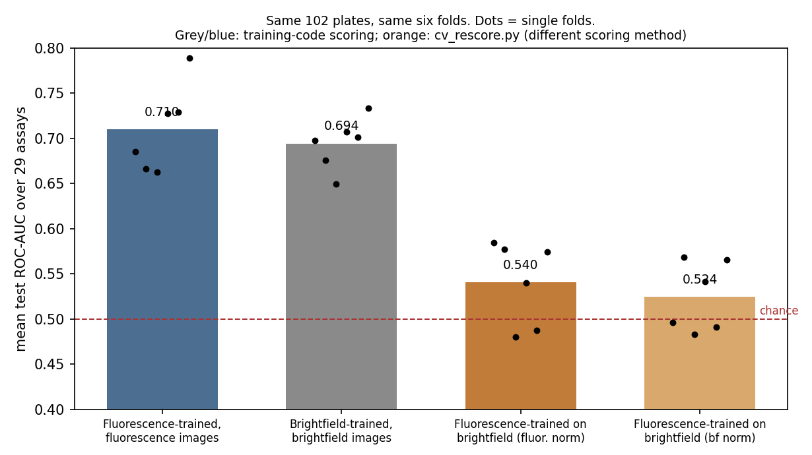

# Brightfield vs fluorescence (ResNet-50, 448 px, same 102 plates)

A one-channel brightfield ResNet-50 and a five-channel fluorescence ResNet-50 were trained at 448 px on the same 102 plates (of 174; 88,130 images of 4,836 compounds), one job per fold, over all six folds (same split and compound-level aggregation as the main benchmark). The question: do the fluorescence channels carry information that brightfield lacks?

Folders: `brightfield_resnet_r448/` and `fluorescence_resnet_r448_102plates/` each hold cv_summary.csv (per-fold test ROC-AUC), cv_per_assay.csv, cv_fold_spread.png, cv_per_assay.png and cv_val_curves.png (produced by aggregate_cv.py). `compare_resnet_output.txt` is the saved output of compare_resnet.py, including the paired tests below.

These numbers use the 102-plate subset and are not comparable with the full-dataset ResNet-50 rows of the main benchmark. Folds 2 and 5 have 28 evaluable assays instead of 29 for both models.

| Fold | Brightfield | Fluorescence | Brightfield minus fluorescence |
|---|---|---|---|
| 0 | 0.6973 | 0.6852 | +0.0122 |
| 1 | 0.6754 | 0.6657 | +0.0096 |
| 2 | 0.6496 | 0.6624 | -0.0128 |
| 3 | 0.7071 | 0.7275 | -0.0205 |
| 4 | 0.7010 | 0.7285 | -0.0275 |
| 5 | 0.7335 | 0.7890 | -0.0555 |
| Mean (SD) | 0.6940 (0.0287) | 0.7097 (0.0484) | -0.0157 |

Paired t-test on the six folds: difference -0.0157 (SD 0.0252), p = 0.1864, brightfield better on 2 of 6 folds. Not significant; fluorescence is ahead on four folds (2 to 5), so a small fluorescence advantage is not ruled out.

The same comparison file also shows that end-to-end trained brightfield ResNet-50 at 448 px beats frozen brightfield DINOv3 at 448 px (+0.0353, p = 0.017, better on 6 of 6 folds) and frozen brightfield Cell-DINO at 224 px (+0.1058, p = 0.0001, 6 of 6 folds).

## Controls requested after the supervisor meeting (November 2026)

### Fluorescence-trained model scored on brightfield images

No retraining. The five-channel ResNet-50 trained on fluorescence (102 plates, 448 px) was scored on the brightfield
images of the same test compounds, once with the fluorescence image statistics and once with the brightfield statistics
(brightfield/dump_predictions_bf5.py, brightfield/cv_rescore.py, brightfield/make_control_plot.py).
Table, csv and figure are in control_fluorescence_on_brightfield/.

| Condition | Mean AUC | SD over folds | Fold range | Scoring |
|---|---|---|---|---|
| Fluorescence-trained, fluorescence images | 0.710 | 0.048 | 0.66-0.79 | training code |
| Brightfield-trained, brightfield images | 0.694 | 0.029 | 0.65-0.73 | training code |
| Fluorescence-trained on brightfield (fluor. norm) | 0.540 | 0.047 | 0.48-0.58 | cv_rescore.py |
| Fluorescence-trained on brightfield (bf norm) | 0.524 | 0.039 | 0.48-0.57 | cv_rescore.py |

The fluorescence-trained model does not transfer to brightfield images: its score falls to about 0.5 (chance level).

### Brightfield through the one-channel adaptation

Question: would a brightfield image copied into every input channel behave differently from the one-channel model?
The first layer of each one-channel model sums the pretrained filters over the input channels, which gives the same
response as feeding the grayscale image copied into every channel. This was checked numerically
(brightfield/06_verify_1ch_models.py, brightfield/07_verify_sum_adaptation.py, cluster/jobs/robin-bioact-brightfield-adaptcheck-cpu.yaml;
output in first_layer_check.txt). Largest absolute difference between the adapted first layer and the reference:

| Model | Largest difference | Magnitude of the reference |
|---|---|---|
| ResNet-50, first convolution | 8.6e-06 | 14.3 |
| DINOv3, patch embedding | 1.2e-05 | 5.4 |
| Cell-DINO, patch embedding | 1.2e-06 | 2.0 |

The differences are at floating-point rounding level, so no separate model on a three-channel copy was trained.
